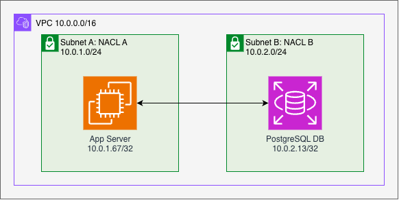
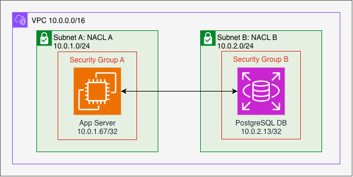
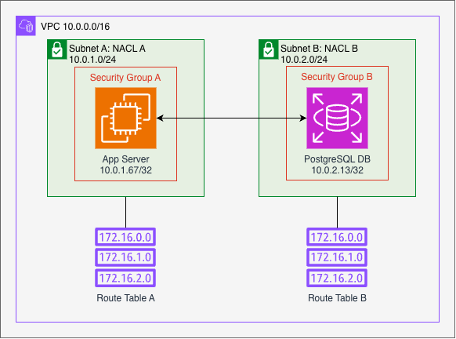

## Introduction

Understanding networking was challenging when I first started working with AWS. I had some basic knowledge already, but once I had to get hands-on, it was evident I needed a deeper understanding. In this post I will cover the basic resources to understand the foundation of how networking works in AWS. However, I will assume that you know what an IP address and a network interface are.

There are many different resources in AWS, they continually add more to their catalog, and expand the features of existing ones. Since this is a beginner-friendly post, I will focus only on the most fundamental ones. I tried to avoid going into too many technical details. There is plenty of official documentation to go deeper into the technicalities of each resource. My aim with this post is to provide easy explanations for beginners, with as little technical details as possible.

## Basic AWS Networking Components

These are simply the ones I consider to be the most basic networking AWS resources and concepts that a beginner needs to understand.

### Availability Zone (AZ)

Just like every other big public cloud provider, AWS uses the concept of Regions and Availability Zones (AZs).

A Region is a place in the world where they have a cluster of data centers. And an AZ is simply one of those data centers in the Region.

Even though all the AZs are within the same Region, they are physically separated from each other to prevent as much as possible all data centers from being affected at the same time by any type of catastrophe.

### Virtual Private Cloud (VPC)

This is your private network. Think of it as a logical container with a defined number of slots (IP addresses) for whatever you want to put inside of it; EC2 or RDS instances, ECS tasks, ALBs, etc.

However, it needs to be subdivided using subnets before anything can be added. Whatever you want to add, for it to be part of the VPC, it needs to have an Elastic Network Interface (ENI).

The amount of available slots in your VPC are defined by a Classless Inter-Domain Routing (CIDR) block, which has to be specified on creation of the VPC. After creation more CIDR blocks can be added, thus extending the quantity of slots. Though, this wasn't always the case.

### Subnets

Subnets are smaller logical containers within your VPC with more specific purposes.

A common example is having a subnet for publicly accessible resources, like an internet-facing Application Load Balancer (ALB), another subnet for the application servers, and one last subnet for data bases. This is just one simple example. Depending on the architecture used, there can be different subnets for different more general or more specific purposes.

A subnet must be created in one AZ, and one AZ only, but one AZ can have multiple subnets. It is a good practice to create subnets in at least 2 different AZs. This allows you to create resources in more than one data center and introduce high availability to your architecture.

### Network Access Control List (Network ACL)

It is a list of rules that control ingress and egress access to the resources in a subnet. Every subnet must have one Network ACL associated. Since the Network ACL is evaluated at the subnet level, its rules affect the traffic of all resources in that subnet.

In a Network ACL, rules are evaluated by their number. The lower the number, the sooner it will be evaluated. It is important to understand the order in which your rules will be evaluated, to avoid unintentionally denying traffic that should be allowed, or vice versa.

I prefer to use high numbers to leave room in between each rule. This way you will be able to add more rules between the existing ones if necessary.

One very important characteristic of Network ACLs is that they are stateless. This means that when you want to allow traffic, you have to add an inbound and an outbound rule for the request and the response traffic to flow properly. Let me try to make it clearer with an example.

In the image above, we have an app server and a PostgreSQL DB. We want our Network ACLs to allow only the necessary traffic for the app server to connect to the DB and nothing else. When a new Network ACL is created, it blocks all traffic by default. For our app server to connect to our DB, we need to create 2 rules in each Network ACL, so 4 rules in total:

#### Network ACL A (App Server)

##### Inbound rules
Inbound rule to allow the response from the DB to enter subnet A.
| Rule number | Type | Protocol | Port range | Source | Allow/Deny |
| ----------- | ---- | -------- | ---------- | ------ | ---------- |
| 500 | Custom TCP | TCP | 1024 - 65535 | 10.0.2.13/32 | Allow |
| * | All traffic | All | All | 0.0.0.0/0 | Deny |

##### Outbound rules
Outbound rule to allow the app server request to the DB to exit subnet A.
| Rule number | Type | Protocol | Port range | Destination | Allow/Deny |
| ----------- | ---- | -------- | ---------- | ----------- | ---------- |
| 500 | PostgreSQL | TCP | 5432 | 10.0.2.13/32 | Allow |
| * | All traffic | All | All | 0.0.0.0/0 | Deny |

#### Network ACL B (Data Base)

##### Inbound rules
Inbound rule to allow the request from the app server to enter subnet B.
| Rule number | Type | Protocol | Port range | Source | Allow/Deny |
| ----------- | ---- | -------- | ---------- | ------ | ---------- |
| 500 | PostgreSQL | TCP | 5432 | 10.0.1.67/32 | Allow |
| * | All traffic | All | All | 0.0.0.0/0 | Deny |

##### Outbound rules
Outbound rule to allow the response from the DB to exit subnet B.
| Rule number | Type | Protocol | Port range | Destination | Allow/Deny |
| ----------- | ---- | -------- | ---------- | ----------- | ---------- |
| 500 | Custom TCP | TCP | 1024 - 65535 | 10.0.1.67/32 | Allow |
| * | All traffic | All | All | 0.0.0.0/0 | Deny |

The flow of the connection would be as follow:
1. The App Server sends a PostgreSQL request to the DB instance. It is first evaluated by the outbound rule of the Network ACL A.
2. Then the request needs to be received by the DB instance. This time it is evaluated by the inbound rule of the Network ACL B.
3. After receiving the request, the DB instance sends a response to the App Server. Now it is evaluated by the outbound rule of the Network ACL B.
4. Finally, the response needs to be received by the App Server. So it is evaluated by the inbound rule of the Network ACL A.
5. Now there is a connection established between the App Server and the DB.

Remarks:
- You may have noticed that in the Network ACL A inbound rule and in the Network ACL B outbound rule, the port range is ***1024 - 65535***. This is because this is an ephemeral port range. This ephemeral port range is necessary because when the App Server sends the PostgreSQL request, it sends it to port 5432, but it is sent from a random port within that ephemeral port range.
- The rule at the bottom of each set of rules, the ones that is of type **"All traffic"** is the default behavior of the Network ACL. It blocks all traffic that is not allowed in one of the previous rules. It doesn't have a number assigned because it is always evaluated last.
- By setting the rule number to 500, there is plenty of space before and after that rule to add more rules. The highest possible number to use is 32766, so don't be afraid of using high numbers.

### Security Group (SG)

A SG does basically the same as a Network ACL, but with three crucial differences.

1. SGs are scoped to a resource in specific, or a resource's ENI to be precise, e.g. an EC2 instance. Unlike a Network ACL, which is scoped to a subnet.
2. SGs are stateful. This means that they have a sort of "memory". When an outbound request is sent, it "remembers" and allows the inbound response related to it. Hopefully this will be clearer with the example below.
3. SG rules are not evaluated by number or priority. The order of the rules doesn't matter. There are no deny rules, SG rules only allow traffic, everything else is denied.

Let's extend the same example from the Network ACLs to now have a SG for each resource:

So we have our subnets with the Network ACLs already configured to allow the App Server to connect to the DB. But now we SGs in the mix, which are blocking all traffic. So we need to add the necessary rules to allow the traffic between the App Server and the DB.

#### Security Group A (App Server)

##### Outbound rules

| SG rule id | Type | Protocol | Port range | Destination | Description |
| ---------- | ---- | -------- | ---------- | ----------- | ----------- |
| sgr-111... | PostgreSQL | TCP | 5432 | Security Group B | DB's Security Group |
| sgr-222... | All traffic | All | All | 0.0.0.0/0 | Allow all traffic, this rule makes the other one unnecessary |

#### Security Group B (Data Base)

##### Inbound rules

| SG rule id | Type | Protocol | Port range | Source | Description |
| ---------- | ---- | -------- | ---------- | ------ | ----------- |
| sgr-333... | PostgreSQL | TCP | 5432 | 10.0.1.67/32 | App Server's IP, more restrictive |
| sgr-444... | PostgreSQL | TCP | 5432 | Security Group A | App Server's SG, more permissive. This rule makes the other one unnecessary |

Remarks:
- Since SGs are stateful, there's no need to worry about ephemeral ports nor rules on the "other direction" of the SGs. The App Server needs to send the request for connection, so only the outbound rule is necessary. And the DB needs to receive the request for connection, so only the inbound rule is necessary. Each SG keeps track of the inbound or outbound flow. When the App Server sends the request, the SG "remembers" and auto-permits the matching response. Same for the DB' SG inbound rule.
- The second outbound rule in SG A, sgr-222..., allows all the outbound traffic. This rule is added by default when creating a new SG, and it makes the first rule, sgr-111..., redundant. Keep the first rule if you want to be specific about what the App Server can reach, or keep the second one if you want to allow it to reach anywhere.
- Similarly, the second inbound rule in SG B, sgr-444..., makes the first rule, sgr-333..., redundant. But this time, at a lower scale. The first rule allows only the specific IP address of the App Server, the second one allows only the resources that have SG A assigned. Say, you have 3 App Servers that need to connect to the same DB, instead of adding 3 rules, one for each server IP address, you simply add one rule allowing the SG, and make sure the servers have the SG A assigned of course.
- SG A doesn't have any inbound rules, so it will block any request trying to go into the server. Same for SG B about the outbound rules, no outbound communication is allowed as it is.
- Hopefully the extra rules didn't generate too much confusion. But in essence, only the rules sgr-111... and sgr-333... are really required to allow the communication between the App Server and the DB in a least-privileged approach. Only one rule in each SG, in comparison to the Network ACLs, that needed 2 rules each to achieve the same behavior.

### Route Tables

This one was specially challenging at the beginning for me. I don't know why, but it was very hard to understand what the destination and the target actually mean. My guess is because destination and target can be used as synonyms in other contexts. Now I think about it, and it just makes sense and I can't believe I struggled so much with it at the beginning. So the destination is is exactly that, where you want to go in the end, where you want to reach. And target is how you get to that destination from that route table, is the next step to take to be able to reach the destination. Let's use the following route table as an example:

Every subnet must have one route table associated, only one, and a route table can be associated to several subnets. It can also be associated to other AWS resources, not only subnets, through an edge association, but this is for more advanced use cases and out of the scope of this post.

We can define a route table as a list of instructions, routes, on where to send the traffic according to their destination. This is very much like asking for directions to a GPS or a maps application. You enter your destination, and it will tell you which route to follow to get there. Let's continue expanding our previous example. I'll add 2 route tables now, one for each subnet:

#### Route Table A
| Destination | Target |
| ----------- | ------ |
| 0.0.0.0/0   | nat-xxx |
| 10.0.0.0/16 | local |

#### Route Table B
| Destination | Target |
| ----------- | ------ |
| 10.0.0.0/16 | local |

Since our example is very simple, only one route is necessary for our resources to communicate with each other because they are in the same VPC. And this is thanks to the "local" route, which is added by default when a new route table is created. This route is in every route table and ensure that every subnet in the VPC has a route to reach all other resources in the same VPC.

Then there is the first route in Route Table A, 0.0.0.0/0 -> nat-xxx. 

The first route is sending all traffic to a NAT GW (see below). The second route is sending all the traffic going to the specific IP address 10.1.1.1 to an elastic network interface (ENI). This means that from whichever subnet that uses this route table, all traffic going to 10.1.1.1 will be sent to the eni-xxx, and all other traffic going to any other IP address will be sent to nat-xxx. That's basically it, very simple.

They define where a subnet's traffic has to go. You assigned a route table to a subnet, and this is how it knows where to send the traffic.

For example, in subnet A you need all your resources to be able to access the internet because they need to download version patches or whatever, so in subnet A's route table you define a route to send all traffic, 0.0.0.0/0 to an Internet Gateway or a NAT Gateway, more about them below.

A subnet can only have assigned one route table, but the same route table can be assigned to several subnets. Spoiler alert, the routes in a route table are a very important component of what make sa subnet public or private.

### Internet Gateway (IGW)

As its name says it, this is the VPC's gateway to the internet. It's an AWS managed resources, so once created, it simply has to be attached to the VPC and is ready. A route table can also be associated to an IGW, but this is for more advanced use cases. Usually, the IGW is ready to go as it is.

### NAT Gateway (NAT GW)

It enables communication from resources within your "private" subnets to other resources outside of your VPC, without allowing the external resources to connect.

imagine you live in a closed community, and there is a messanger company who you can hire anytime you need to run an errand, they do it for you, they go and buy or do wahtever, and bring you back the result, and that's it. So no one from outside of the communicaty can reach you, only you can reach them if you send a messanger. 

There ar public and private ones, but mainly public NAT GW are used. THe pirvate one does the same, but not to the internet but to other VPCs or on-prem networks.

## Example of an architecture that uses all these components

## Conclusion

whenever you have reacbility issues, check the SGs, route tables, and Network ACLs. MOst of the time, the isseu is in one of those resources. I not, try a reachability analysis.